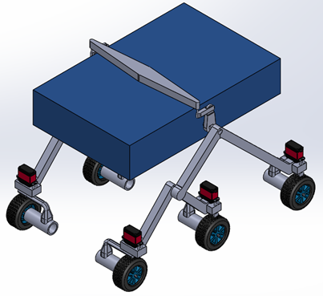
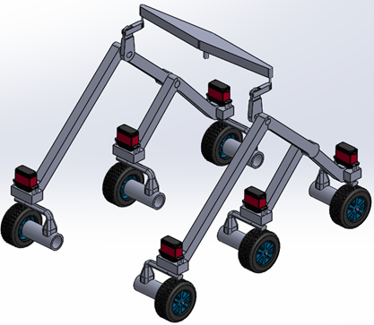
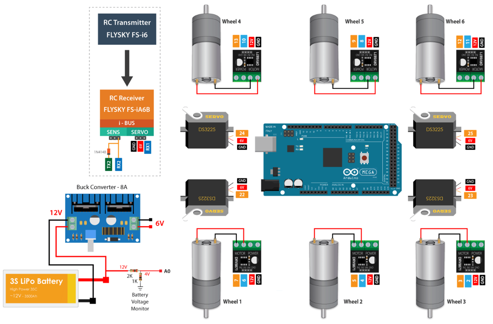

# 6WD Rocker-Bogie Rover Chassis with 4-Wheel Ackermann Steering

A 6-wheeled rough-terrain mobile exploration platform featuring an un-sprung rocker-bogie suspension system, top-mounted mechanical differential bar, and independent 4-wheel Ackermann steering. Designed in SolidWorks with analytical validation for motor torque, scrub torque, and power distribution.

---

## 📌 Technical Specifications

| Parameter | Value | Design Context |
| :--- | :--- | :--- |
| **Gross Vehicle Mass ($m$)** | 10.0 kg | Structural frame + electronics + payload[cite: 11] |
| **Dimensions ($L \times W \times H$)** | $0.60 \times 0.40 \times 0.45\text{ m}$ | Box-structure payload envelope[cite: 7, 11] |
| **Wheelbase ($l_{wb}$)** | 0.515 m | Front-to-rear axle center-to-center distance[cite: 14] |
| **Wheel Tread ($T$)** | 0.315 m | Center-to-center distance between lateral wheels[cite: 18] |
| **Wheel Diameter ($d$) / Radius ($r$)** | $0.085\text{ m} \ / \ 0.0425\text{ m}$ | High-traction treaded rubber tires[cite: 11] |
| **Target Linear Speed ($v$)** | $0.5\text{ m/s}$ | Low-speed high-torque operation[cite: 11] |
| **Rated Wheel Speed ($\omega$)** | 11.76 rad/s (~110–112 RPM) | Direct output speed from drive gearmotors[cite: 11] |
| **Max Design Incline ($\theta$)** | $25^\circ$ | Extreme rocky surface grade capability[cite: 12] |
| **Rolling Resistance ($\mu_{roll}$)** | 0.03 | Coarse gravel / rocky debris terrain[cite: 12] |
| **Ground Scrub Friction ($\mu_{s}$)** | 0.8 | Static scrub torque estimation surface[cite: 16] |

---

## ⚙️ Mechanical Architecture

### 1. Rocker-Bogie Suspension Kinematics
* **Linkage Dimensions:** Rocker length $l_r = 0.340\text{ m}$, Bogie length $l_b = 0.170\text{ m}$ ($l_r = 2 \cdot l_b$)[cite: 14]. Central pivot height $h_w = 0.222\text{ m}$[cite: 14].
* **Passive Obstacle Climbing:** Does not rely on springs or shock absorbers[cite: 7]. Weight is passively equalized over all 6 wheels to maintain continuous surface traction across uneven vertical obstacles[cite: 7].
* **Overhead Differential Bar:** A top-mounted balancing link connects the left and right rocker assemblies[cite: 8]. Pitch deflection on one side induces equal and opposite displacement on the other, stabilizing chassis attitude without internal gear trains[cite: 8].

### 2. Four-Wheel Independent Ackermann Steering
To eliminate lateral wheel scrub during cornering, both front and rear axle pairs steer independently according to Ackermann geometry[cite: 9, 17]:

$$\tan \alpha_i = \frac{l_{wb} / 2}{r_{path} - T / 2} \quad \Big| \quad \tan \alpha_o = \frac{l_{wb} / 2}{r_{path} + T / 2}$$

For a design path radius $r_{path} = 1.0\text{ m}$[cite: 17]:
* **Inner Wheel Angle ($\alpha_i$):** $16.99^\circ$[cite: 18]
* **Centerline Angle ($\alpha$):** $14.44^\circ$[cite: 18]
* **Outer Wheel Angle ($\alpha_o$):** $12.54^\circ$[cite: 18]

---

## ⚡ Powertrain & Electrical Design

### Sizing & Torque Calculations
* **Drive Motors (6x):**
  * Normal force per wheel on $25^\circ$ incline: $W_{wheel} = 14.82\text{ N}$[cite: 14]
  * Continuous total drive torque: $\tau_{total} = \tau_{roll} + \tau_{incline} + \tau_{accelerate} = 1.916\text{ Nm}$[cite: 15]
  * Required torque per wheel: $\tau_m = 4.26\text{ Nm}$ (with $10:1$ reduction and $\eta_d = 0.75$)[cite: 13, 15]
  * **Motor Specification:** DC Gearmotors with rated stall torque of **$6.4\text{ to }8.5\text{ Nm}$** and continuous peak power $\approx 6.3\text{ W}$ each[cite: 15, 16].
* **Steering Actuators (4x):**
  * Stationary scrub torque: $\tau_{scrub} = 0.504\text{ Nm}$[cite: 16]
  * Total peak steering torque: $\tau_{steering} = 0.797\text{ Nm} \approx 0.8\text{ Nm}$[cite: 16]
  * **Actuator Specification:** RDS3225 / 25 kg·cm high-torque digital metal-gear servos.
* **Power Supply:**
  * Total peak mechanical/electrical load: $P_{total} = (6 \times 6.3\text{ W}) + (4 \times 9.7\text{ W}) = 76.6\text{ W}$[cite: 17]
  * System Current Draw at 12V: $I = \frac{76.6\text{ W}}{12\text{ V}} = 6.38\text{ A}$[cite: 17]
  * **Battery Pack:** 3S LiPo battery (11.1V–12.6V), minimum capacity **$7.0\text{ Ah}$** for $>1\text{ hour}$ continuous field autonomy[cite: 10, 17].
  * Step-down regulation: 12V-to-6V 8A synchronous buck converter dedicated to the digital servo bus[cite: 10].

---

## 🎛️ Control Architecture

* **Microcontroller:** Arduino Mega 2560[cite: 10]
* **Drive Motor Drivers:** H-Bridge bidirectional driver modules[cite: 10]
* **Telemetry & Comms:** 
  * FlySky FS-i6 RC Transmitter via FS-iA6B Receiver (PWM / i-BUS)[cite: 10]
  * Analog voltage divider monitoring LiPo cell depletion[cite: 10]
* **Firmware Features:**
  * Multi-channel PWM drive command mixing
  * Real-time Ackermann angle interpolation for front and rear servo pairs[cite: 9, 17]
  * Modular design ready for ROS / Jetson / Pi integration and autonomous obstacle avoidance[cite: 6, 23]

---

## 📂 CAD Model Availability

All mechanical components are modeled at a 1:1 scale in SolidWorks and available under `/cad`:
* `full_rover_assembly.STEP`: Standard exchange format for any CAD software.
* `/cad/stl_3d_print/`: Ready-to-slice files for custom hubs, servo holders, and suspension pivots.

---

## 👤 Author
**Malithi Elangasinha**  
Mechatronics Engineering Graduate, Uva Wellassa University of Sri Lanka  
* LinkedIn: [Malithi Elangasinha](https://www.linkedin.com/in/malithi-elangasinha)  
* Email: melangasinha01@gmail.com
